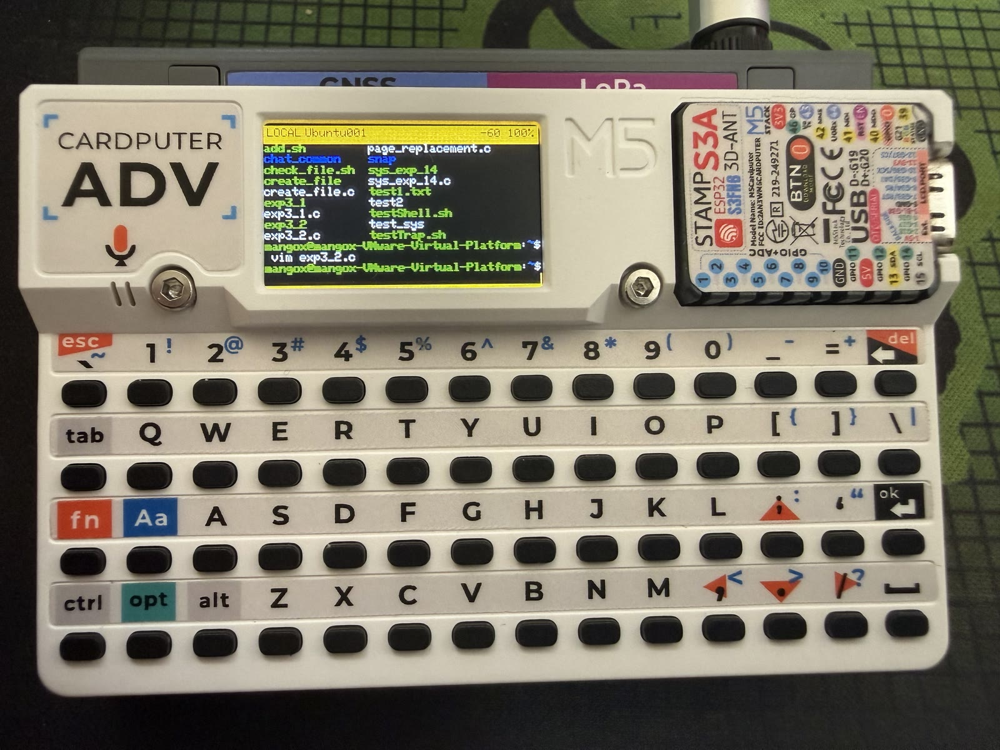
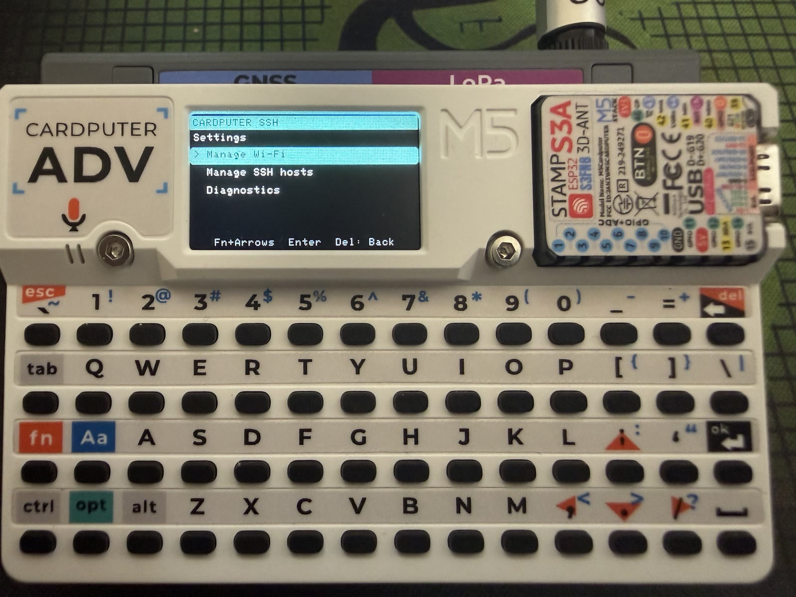

# M5Stack Cardputer SSH

[中文说明](README.zh-CN.md)

A portable, general-purpose SSH client for the **M5Stack Cardputer ADV**.
Connect directly from the Cardputer to any reachable SSH server that accepts
username/password authentication—no companion service, Python program, or
compile-time `secrets.h` is required.

Compatible targets include Raspberry Pi OS, Linux distributions such as
Debian, Ubuntu, Fedora, and Arch, Windows OpenSSH Server, macOS Remote Login,
NAS devices, OpenWrt routers, virtual machines, and cloud servers. The target
only needs to be reachable on the network and have SSH enabled.

<table>
  <tr>
    <td width="50%"></td>
    <td width="50%"></td>
  </tr>
  <tr>
    <td align="center">SSH terminal</td>
    <td align="center">On-device settings</td>
  </tr>
</table>

> This is a community project for M5Stack hardware and is not affiliated with
> or endorsed by M5Stack.

## Highlights

- Configure everything on the device: up to 4 Wi-Fi profiles and 8 SSH hosts
- Scan 2.4 GHz Wi-Fi channels 1–13, including hidden-network entry
- Discover generic `_ssh._tcp` mDNS services or enter hostname/IP/port manually
- Verify the server's SHA-256 host-key fingerprint before authentication
- Save a password per host or prompt on every connection
- Launch a saved host explicitly; startup never connects to SSH automatically
- Use a green REMOTE terminal or orange LOCAL read-only scrollback mode
- Use Cardputer keys including Aa, Fn, Ctrl, Alt, Opt, arrows, F1–F12, Tab,
  Escape, Backspace, and forward Delete
- Run common full-screen programs such as `vim`, `nano`, `top`, `htop`, and
  `tmux` within the documented terminal limits
- Keep diagnostics privacy-safe: credentials and profile contents are not shown

The built-in bounded `xterm-256color` terminal uses a 40×13 PTY, primary and
alternate screens, 120 rows of scrollback, 256 colors, UTF-8 decoding, and
common Unicode arrows, borders, blocks, Braille, and Latin-1 characters.

## Download and flash

The easiest path for most users is the latest
[GitHub Release](https://github.com/MangoX0567/M5Stack-Cardputer-SSH/releases/latest).

### First installation

1. Download `M5Stack-Cardputer-SSH-full.bin` from the latest Release.
2. Install [Python](https://www.python.org/) and esptool:

   ```bash
   python -m pip install --upgrade esptool
   ```

3. Connect the Cardputer ADV with a USB-C data cable and identify its serial
   port. Flash the merged image at `0x0`:

   ```bash
   python -m esptool --chip esp32s3 --port COM4 --baud 460800 write-flash 0x0 M5Stack-Cardputer-SSH-full.bin
   ```

   Replace `COM4` with your port, such as `COM7` on Windows or
   `/dev/ttyACM0` on Linux.

The full image is intended for a first installation. It writes the complete
firmware layout and clears previously stored Wi-Fi and SSH profiles in NVS.
Do not disconnect USB power while flashing.

### Updating while preserving profiles

Download `M5Stack-Cardputer-SSH-firmware.bin` from the Release and write the
application image at `0x10000`:

```bash
python -m esptool --chip esp32s3 --port COM4 --baud 460800 write-flash 0x10000 M5Stack-Cardputer-SSH-firmware.bin
```

This app-only update preserves the existing partition table and NVS profiles.
Use it only when updating an existing installation of this project. Release
checksums are provided in `SHA256SUMS.txt`.

## First use

On first boot, add a 2.4 GHz Wi-Fi network on the Cardputer. After Wi-Fi
connects, the device opens `SSH HOSTS`. Discover an `_ssh._tcp` service or add
any server manually with its name, hostname/IP, port, and username.

The first connection displays the server's SHA-256 host-key fingerprint.
Verify it against the server before choosing Trust. The password is read or
sent only after trust is accepted. Later host-key changes are treated as a
hard failure until trust is deliberately reset in Settings.

Settings can add, edit, enable, disable, delete, prioritize, and reorder Wi-Fi
or host profiles. A host can save its password in ESP32 NVS or request it for
each connection.

## Keyboard

Hold `Aa` to use the printed alternate layer temporarily, or tap and release
`Aa` to lock/unlock that layer. Examples: `Aa+1` → `!`, `Aa+2` → `@`, and
`Aa+;` → `:`.

| Context | Keys | Action |
|---|---|---|
| Menus | Fn + printed arrow keys | Navigate |
| Menus | Enter / Del | Select / back |
| Text fields | Del / Fn+Del | Backspace / forward Delete |
| REMOTE | Printable / Aa keys | Send the resolved character |
| REMOTE | Fn+arrows, Fn+1–0 | Arrows and F1–F12 |
| REMOTE | Ctrl / Alt + key | Control byte / Escape-prefixed character |
| REMOTE | Opt+Space | Switch to LOCAL without sending Space |
| REMOTE/LOCAL | Opt+Enter | Open Settings |
| REMOTE/LOCAL | Opt+Del | Open the cancel-first end-session dialog |
| LOCAL | Fn+Up/Down | Scroll one line |
| LOCAL | Fn+Left/Right | Scroll one page |
| LOCAL | Del | Jump to the newest output |

LOCAL continues receiving SSH output but sends no terminal bytes.

## Build and modify

Developers can clone the complete PlatformIO project:

```bash
git clone https://github.com/MangoX0567/M5Stack-Cardputer-SSH.git
cd M5Stack-Cardputer-SSH
```

Install VS Code and the **PlatformIO IDE** extension, open the repository root,
and use **PlatformIO: Upload**. PlatformIO Core users can run:

```bash
pio test -e native
pio run -e m5cardputer-adv
pio run -e m5cardputer-adv -t upload
```

Ordinary PlatformIO upload writes the application without erasing NVS. The
device stores profiles through its UI, so there is no credential header to
edit. See [docs/architecture.md](docs/architecture.md) for component boundaries,
security behavior, terminal limits, and verified resource usage.

Contributions and focused improvements are welcome. Please keep credentials,
private keys, build output, editor-specific files, and serial logs out of
commits. The GitHub Actions workflow runs native tests and a production build.

## Enable SSH on a target

The exact command depends on the remote operating system. For systemd-based
Linux distributions where the service is named `ssh`:

```bash
sudo systemctl enable --now ssh
```

Some distributions call the service `sshd`. Windows uses the optional OpenSSH
Server feature, and macOS exposes SSH through **Remote Login**. Port `22` is
the default, but any configured port can be saved on the Cardputer.

## Optional two-line Bash prompt

If a long username or hostname leaves little room for commands, add this line
to the remote Bash user's `~/.bashrc`:

```bash
PS1='\u@\h:\w\n\$ '
```

Run `source ~/.bashrc` or reconnect. Identity and path remain on the first
line, while input starts after `$ ` or `# ` on the second line. Remove the
line to undo the change. The firmware never detects or modifies prompts, so
full-screen terminal programs remain unaffected.

## Security and limitations

- Use a dedicated unprivileged remote account without passwordless `sudo`.
- Saved credentials live in ordinary ESP32 NVS, not a secure element. Anyone
  with physical flash access may be able to extract them.
- Verify an unexpected host-key change before resetting trust.
- This release supports SSH username/password authentication. SSH private-key
  and public-key authentication are not yet supported.
- The terminal intentionally omits CJK/double-width layout, combining and
  bidirectional text, mouse protocols, terminal graphics, OSC clipboard, and
  live PTY resize.

## License and references

Released under the [MIT License](LICENSE).

The device-first UI was informed by
[Bruce firmware](https://github.com/BruceDevices/firmware), while PTY and key
behavior were compared with
[SSHClient-M5Cardputer](https://github.com/aat440hz/SSHClient-M5Cardputer).
No source code, assets, branding, or artwork from those projects is copied.
